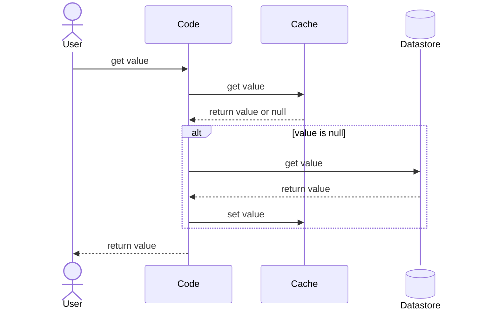
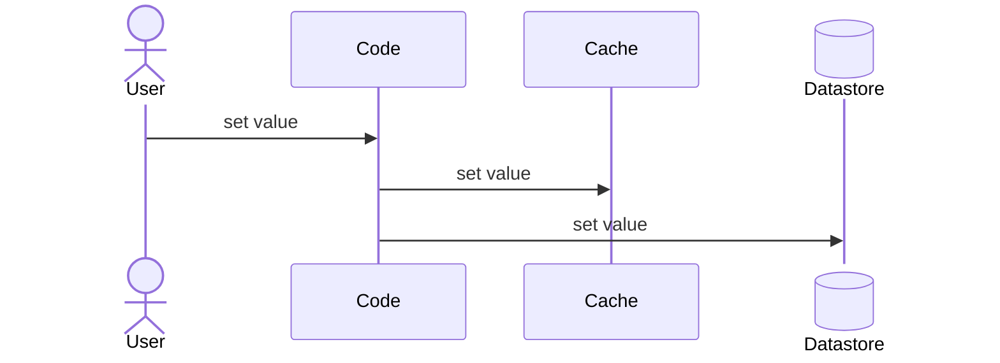
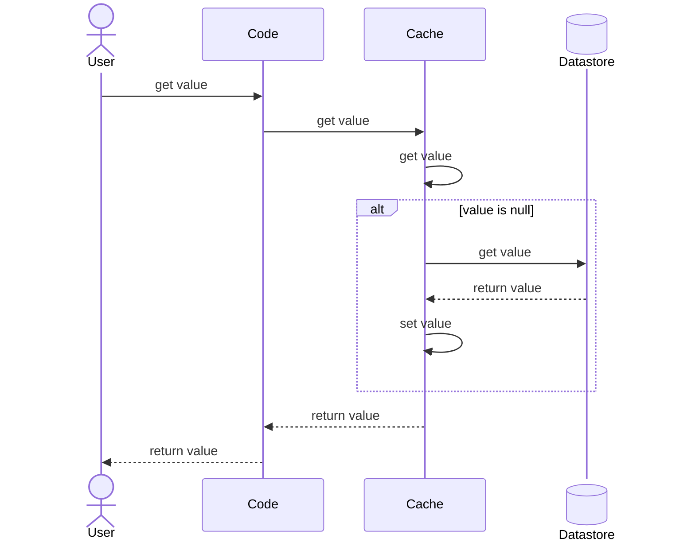
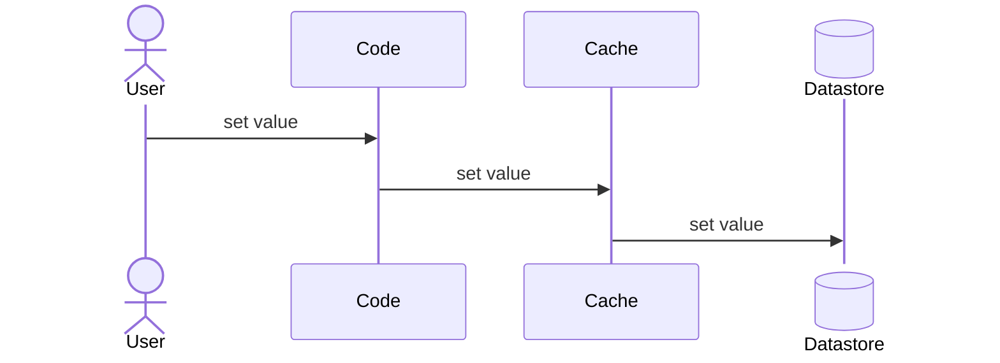
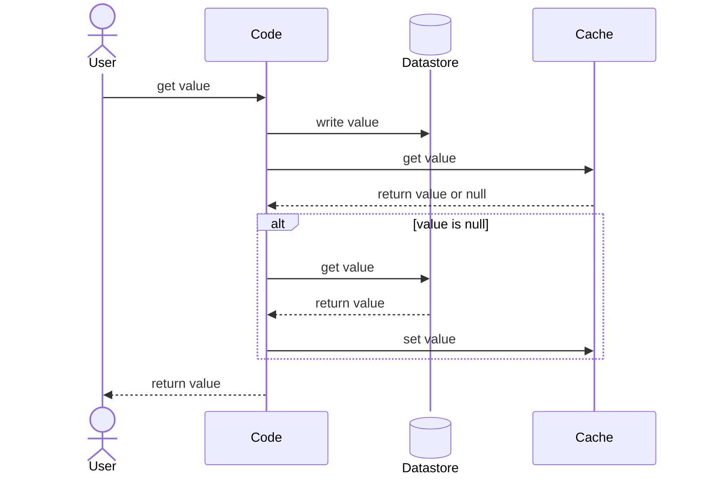

When your application starts slowing down, the reason is probably a bottleneck somewhere in the execution chain. Sometimes, this bottleneck is due to a bug. Sometimes, somebody didn’t set up the optimal configuration. And sometimes, the process of fetching the data is the bottleneck.

One option would be to change your whole architecture. Before moving to such a drastic, and probably expensive measure, one can consider a trade-off: instead of getting remote data every time, you can store the data locally after the first read. This is the trade-off that caching offers: **stale data vs. speed**.

Deciding to use [caching](https://hazelcast.com/glossary/caching/) is just the first step in a long journey. The next step is to think about **how** your application and the cache will interact. This post focuses on your options regarding those interactions.

==🔴To be checked https://medium.com/@sonal.sadafal/%EF%B8%8F-cache-architecture-patterns-06af40434bb4==

## Cache Aside
The **Cache Aside** pattern places the responsibility for managing the cache on the application. When the app requests data, it first checks the cache; if the data isn’t present, it retrieves it from the database and stores it in the cache. This pattern allows fine-grained control over caching but requires more complex logic in the application.

Reads [^2]

Writes:

## Read Through
Allows your application to retrieve data directly from the cache. If the data isn't available in the cache, it fetches it from the database and stores it in the cache for future access. This pattern reduces the number of read operations on the database and speeds up data retrieval.

## Write Through
In the **Write Through** caching pattern, every write operation is performed on both the cache and the database simultaneously. This ensures that the cache always contains the most up-to-date data, providing consistency at the cost of some performance overhead during writes.

## Write Behind/Back
With the **Write Back** pattern, updates to the cached data are written back to the cache first and then asynchronously persisted to the database later. This approach can improve write performance but requires careful handling to ensure data consistency and avoid potential data loss.

## Write Around
The **Write Around** pattern processes writes directly to the database, bypassing the cache. This means that when data is requested afterward, it will be pulled into the cache. This method is beneficial when writes are infrequent compared to reads, minimizing cache pollution with rarely-accessed data.

---
[^1]: https://dev.to/the_infinity/5-caching-patterns-every-developer-should-know-2p9b

[^2]: https://hazelcast.com/blog/a-hitchhikers-guide-to-caching-patterns/
