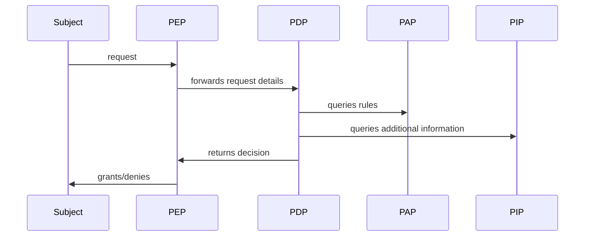

Authorization patterns determine where an application decides and enforces access. A **Policy Enforcement Point (PEP)** protects an operation; a **Policy Decision Point (PDP)** evaluates the applicable policy. [OpenID AuthZEN](https://openid.net/specs/authorization-api-1_0.html) defines an interface between these components. Use the [Authorization Cheat Sheet](https://cheatsheetseries.owasp.org/cheatsheets/Authorization_Cheat_Sheet.html) for baseline controls and [Identity Propagation Patterns](https://cheatsheetseries.owasp.org/cheatsheets/Identity_Propagation_Patterns_Cheat_Sheet.html) for trustworthy caller context [^1].

In the diagrams, a **Policy Administration Point (PAP)** manages rules and a **Policy Information Point (PIP)** supplies attributes used to evaluate them [^1].

> **Policy**: Rule or set of rules that defines the authorization conditions. It specifies Which subject is allowed to What action on What resource in given context [^2]

| Component                         | Role               | Description                                                                                             |
| --------------------------------- | ------------------ | ------------------------------------------------------------------------------------------------------- |
| Policy Enforcement Point (PEP)    | The GateKeeper     | PEP enforces that decision by either granting or denying access (API Gateway/Application itself)        |
| Policy Decision Point (PDP)       | The Brain          | Evaluates access requests against defined policies and returns a decision (Permit/Deny)                 |
| Policy Information Point (PIP)    | The Informant      | Supplies additional information for Decision Making by quering external sources (identity provider, db) |
| Policy Administration Point (PAP) | The Policy Manager | Creates and manages Policies (UI, API)                                                                  |

## Service Level Authorization
Keep enforcement close to the protected resource so it can check the requested action, object, and tenant. Deny by default and [validate permissions on every request](https://cheatsheetseries.owasp.org/cheatsheets/Authorization_Cheat_Sheet.html#validate-the-permissions-on-every-request). Separating policy evaluation from enforcement does not transfer the PEP's responsibility to enforce the result; the [AuthZEN trust model](https://openid.net/specs/authorization-api-1_0.html#section-11.4) explicitly relies on that responsibility [^1].

### Policies in Application Code

The service implements both decision and enforcement logic, using a framework's authorization facilities where possible.

This can suit a small application with a limited policy surface. Centralize checks within the application's authorization layer and test every protected entry point. Scattered conditional checks make omissions and inconsistent policies harder to detect; changing these rules requires deploying application code. Code-based policies are not inherently fail-open.

> **Fail Open**: A system that fails open defaults to an operational or open state in the event of a failure [^3]. It is typically used where **availability is more critical than security**.
> **Fail Closed**: Conversely, a system that fails closed defaults to a closed or secure state[^3]. It is essential in scenarios where **security is paramount**.

![[Pasted image 20261128121655.png]]

| Quality Attribute               | Priority | Explanation                                                                            |
| ------------------------------- | -------- | -------------------------------------------------------------------------------------- |
| Analysability (Maintainability) | Low      | Scattered conditional checks make omissions and inconsistent policies harder to detect |
| Modifiability (Maintainability) | Low      | Changing policies requires deploying application code                                  |
- Internal requirement: The system shall be a small application 
- Specific concern: The system shall have a limited policy surface

### Policies in Application Code

The service remains the PEP but asks a PDP to evaluate policies managed independently of business code. The PDP may be embedded, local, or remote; central policy ownership does not require a single central runtime.

![[Pasted image 20261128121924.png]]

Use this separation when several services need consistent rules and a shared review process. Supply authenticated subject context and authoritative resource attributes, enforce the returned decision before accessing the resource, and deny the operation if no valid decision is available. See [Policy and Data Distribution](https://cheatsheetseries.owasp.org/cheatsheets/Authorization_Policy_And_Data_Distribution_Cheat_Sheet.html) for keeping inputs current and [Decisions and Output Handling](https://cheatsheetseries.owasp.org/cheatsheets/Authorization_Decisions_And_Output_Handling_Cheat_Sheet.html) for enforcing results.

---

[^1]: https://cheatsheetseries.owasp.org/cheatsheets/Authorization_Patterns_Cheat_Sheet.html

[^2]: https://medium.com/identity-beyond-borders/the-four-horsemen-of-authorization-the-p-ps-pep-pdp-pap-and-pip-42717e445ce7

[^3]: https://authzed.com/blog/fail-open
